# FlightVisualizer — Architecture

The following was generated through introspection of this repository by
[gitdiagram](https://github.com/ahmedkhaleel2004/gitdiagram) on November 3rd, 2026.

## Intro

Flight Visualizer is a CLI that retrieves or reuses flight data, turns flight positions into selected KML layers,
and saves shareable KMZ files; it can also launch the first result. The graph follows the documented tracks workflow
and sampled calls. Configuration editing, HTTP and file-backed retrieval, and path/camera/vector layers are included
as documented or indexed capabilities, but some internal wiring is not shown; those relationships are omitted rather
than inferred.

## Diagrams

### Bitmap

### Mermaid

```mermaid
%% Generated by https://gitdiagram.com/noodnik2/flightvisualizer
flowchart TD

subgraph group_cli["CLI and configuration"]
node_entry["Application entry<br/>[main.go]"]
node_commands["Command routing<br/>[root.go]"]
node_tracks_cmd["Tracks command<br/>[tracks.go]"]
node_config_cmd["Config command<br/>[config.go]"]
node_config["Configuration<br/>[config.go]"]
end

subgraph group_retrieval["Flight data retrieval"]
node_workflow["Track generation<br/>[generatetracks.go]"]
node_converter["Flight conversion<br/>[aerotrack2kml.go]"]
node_api["AeroAPI facade<br/>[api.go]"]
node_http_adapter["HTTP retrieval<br/>[httpapi.go]"]
node_file_adapter["Artifact retrieval<br/>[fileapi.go]"]
node_track_data["Flight positions<br/>[api.go]"]
end

subgraph group_rendering["KML visualization"]
node_kml_track["KML assembly<br/>[kmltrack.go]"]
node_camera["Camera layer<br/>[camera.go]"]
node_path["Path layer<br/>[path.go]"]
node_vector["Performance vectors<br/>[vector.go]"]
node_other_layers["Placemark layers"]
end

subgraph group_output["Artifacts and launch"]
node_kmz["KMZ packaging<br/>[kmzsaver.go]"]
node_file_store[("Artifact files<br/>[fileio.go]")]
node_launcher["Open visualization<br/>[launchfile.go]"]
end

node_user(("CLI user"))
node_aero_service{{"FlightAware AeroAPI"}}
node_kml_client(("KML client"))

node_user -->|"invokes"| node_entry
node_entry -->|"executes"| node_commands
node_commands -->|"routes"| node_tracks_cmd
node_tracks_cmd -->|"loads settings"| node_config
node_tracks_cmd -->|"starts generation"| node_workflow
node_user -->|"edits settings"| node_config_cmd
node_workflow -->|"converts flights"| node_converter
node_workflow -->|"configures retrieval"| node_api
node_workflow -->|"selects live source"| node_http_adapter
node_workflow -->|"selects saved source"| node_file_adapter
node_converter -->|"requests flight data"| node_api
node_converter -->|"generates KML"| node_kml_track
node_api -.->|"requests live data"| node_aero_service
node_api -->|"decodes positions"| node_track_data
node_workflow -->|"assembles layers"| node_kml_track
node_kml_track -->|"builds layer"| node_camera
node_kml_track -->|"builds layer"| node_path
node_kml_track -->|"builds layer"| node_vector
node_workflow -->|"packages output"| node_kmz
node_kmz -->|"saves archive"| node_file_store
node_file_adapter -.->|"reads artifacts"| node_file_store
node_workflow -->|"launches first result"| node_launcher
node_user -->|"views output"| node_kml_client

click node_entry "https://github.com/noodnik2/flightvisualizer/blob/main/main.go"
click node_commands "https://github.com/noodnik2/flightvisualizer/blob/main/cmd/root.go"
click node_tracks_cmd "https://github.com/noodnik2/flightvisualizer/blob/main/cmd/tracks.go"
click node_config_cmd "https://github.com/noodnik2/flightvisualizer/blob/main/cmd/config.go"
click node_config "https://github.com/noodnik2/flightvisualizer/blob/main/internal/config.go"
click node_workflow "https://github.com/noodnik2/flightvisualizer/blob/main/internal/generatetracks.go"
click node_converter "https://github.com/noodnik2/flightvisualizer/blob/main/internal/aeroapi/aerotrack2kml.go"
click node_api "https://github.com/noodnik2/flightvisualizer/blob/main/pkg/aeroapi/api.go"
click node_http_adapter "https://github.com/noodnik2/flightvisualizer/blob/main/pkg/aeroapi/httpapi.go"
click node_file_adapter "https://github.com/noodnik2/flightvisualizer/blob/main/pkg/aeroapi/fileapi.go"
click node_track_data "https://github.com/noodnik2/flightvisualizer/blob/main/pkg/aeroapi/api.go"
click node_kml_track "https://github.com/noodnik2/flightvisualizer/blob/main/internal/kml/kmltrack.go"
click node_camera "https://github.com/noodnik2/flightvisualizer/blob/main/internal/kml/builders/camera.go"
click node_path "https://github.com/noodnik2/flightvisualizer/blob/main/internal/kml/builders/path.go"
click node_vector "https://github.com/noodnik2/flightvisualizer/blob/main/internal/kml/builders/vector.go"
click node_other_layers "https://github.com/noodnik2/flightvisualizer/tree/main/internal/kml/builders"
click node_kmz "https://github.com/noodnik2/flightvisualizer/blob/main/internal/persistence/kmzsaver.go"
click node_file_store "https://github.com/noodnik2/flightvisualizer/blob/main/pkg/persistence/fileio.go"
click node_launcher "https://github.com/noodnik2/flightvisualizer/blob/main/internal/os/launchfile.go"

classDef toneNeutral fill:#f8fafc,stroke:#334155,stroke-width:1.5px,color:#0f172a
classDef toneBlue fill:#dbeafe,stroke:#2563eb,stroke-width:1.5px,color:#172554
classDef toneAmber fill:#fef3c7,stroke:#d97706,stroke-width:1.5px,color:#78350f
classDef toneMint fill:#dcfce7,stroke:#16a34a,stroke-width:1.5px,color:#14532d
classDef toneRose fill:#ffe4e6,stroke:#e11d48,stroke-width:1.5px,color:#881337
classDef toneIndigo fill:#e0e7ff,stroke:#4f46e5,stroke-width:1.5px,color:#312e81
classDef toneTeal fill:#ccfbf1,stroke:#0f766e,stroke-width:1.5px,color:#134e4a
class node_entry,node_commands,node_tracks_cmd,node_config_cmd,node_config,node_user,node_kml_client toneBlue
class node_workflow,node_converter,node_api,node_http_adapter,node_file_adapter,node_track_data toneAmber
class node_kml_track,node_camera,node_path,node_vector,node_other_layers,node_aero_service toneMint
class node_kmz,node_file_store,node_launcher toneRose
```

